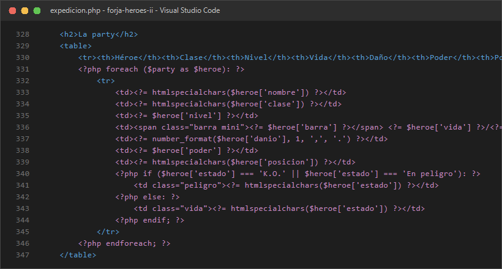
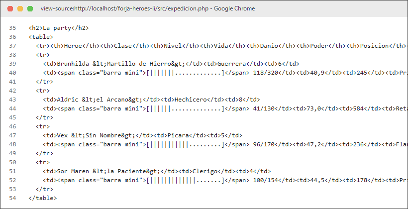
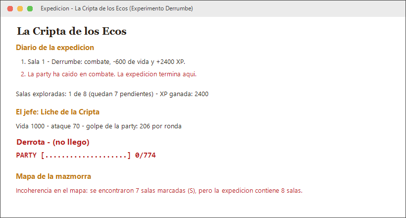
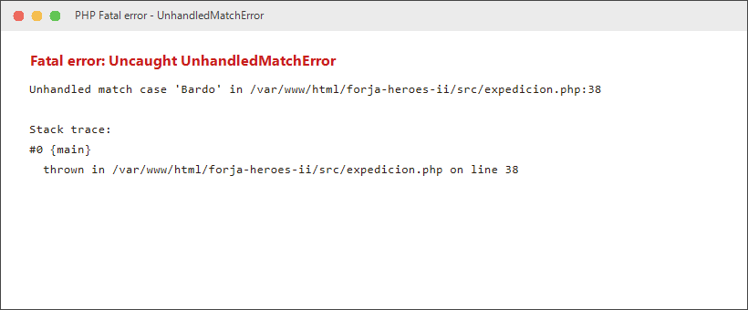

# Memoria · Tarea de refuerzo UD3 «Forja de Héroes II»

**Alumno/a:** Manuel Expósito Sánchez · **Variante:** A · **Fecha:** 18 de octubre de 2026

> Esta tarea **no lleva nota**: sirve para comprobar que dominas lo que necesitarás en la UD5 (sesiones y login) y para preparar la prueba de diagnóstico del RA 3. Las capturas van en `capturas/` y se enlazan así: ``

## 1. Comprobación de resultados

Compara TU página con la tabla de comprobación del enunciado.

| Dato | Valor esperado (enunciado) | Valor de mi página | ¿Coincide? |
|---|---|---|---|
| Poder total de la party | 1243 | 1243 | Sí |
| Daño por ronda | 205,6 | 205,6 | Sí |
| Líder | Aldric | Aldric | Sí |
| Vida al salir de las salas | 305 (de 774) | 305 (de 774) | Sí |
| Resultado frente al jefe (y ronda) | Victoria en la ronda 5 | Victoria en la ronda 5 | Sí |
| Oro final | 2.260,75 mo | 2.260,75 mo | Sí |
| Valor del inventario | 151,20 mo | 151,20 mo | Sí |
| Salas en el mapa | 7 | 7 | Sí |

Todos los valores me dan exactamente igual que en la tabla del enunciado para la Variante A. El poder lo calculé con `(int) round($danio * $nivel)` y para el líder cogí el héroe activo que tuviera más poder. El oro y el valor del inventario los formateé con `number_format` con 2 decimales, comas para decimales y puntos para los miles, añadiendo « mo» al final.

## 2. Bucles y documento resultante




- **En el código hay una fila `<tr>`; en el Ctrl+U, ¿cuántas? ¿Por qué?**
  En mi archivo `expedicion.php` solo escribí una fila `<tr>` dentro del bucle `foreach` (más la fila fija de arriba con los encabezados `<th>`).
  Pero al darle a Ctrl+U en el navegador salen 5 filas `<tr>` en total (la de los encabezados y 4 filas más, una por cada héroe de la party).
  Esto pasa porque el código PHP se ejecuta en el servidor antes de mandar la respuesta. El bucle `foreach` da 4 vueltas (una por cada héroe del array `$party`) y en cada vuelta genera y manda una fila `<tr>` con los datos al HTML resultante.

- **¿Aparece en el Ctrl+U algo de `endforeach` o de `if`? ¿Por qué?**
  No, en el Ctrl+U no sale nada de `endforeach` ni de `if`.
  El servidor ejecuta todo el código PHP internamente y lo único que envía al navegador es el HTML final ya procesado. El navegador nunca ve el código PHP ni sabe que hubo bucles o condiciones para crearlo.

## 3. Experimento: predigo el efecto de un cambio

Añade esta sala **al principio** de `$salas` en tu fichero de datos:

```php
['nombre' => 'Derrumbe', 'tipo' => 'combate', 'valor' => 2400],
```

1. **Predicción** (antes de recargar):
   - **¿Cuántas salas se explorarán?** Se explorará solo 1 sala. Al ser de combate con 2400 de valor, la party pierde `2400 / 4 = 600` de vida. Como la party entraba con 355 de vida, se queda a 0. Entonces entra en el `if ($vidaParty <= 0)`, pone el mensaje en el diario y hace un `break`, saliéndose del bucle en la primera sala.
   - **¿Qué resultado tendrá el jefe?** Saldrá "Derrota · (no llegó)". Al llegar con 0 de vida, el condicional del jefe detecta que no tienen vida y da la derrota directa sin entrar al combate.
   - **¿Qué dirá el aviso del mapa?** Saldrá el aviso diciendo que hay una incoherencia en el mapa, porque en el mapa hay 7 salas (S) y en el array ahora hay 8 salas.
2. **Resultado real:**
   
   El resultado tras recargar coincide con lo que predije: solo se explora 1 sala de 8 (quedan 7 pendientes), la vida se queda a 0, el jefe da derrota sin pelear y sale el aviso de que el mapa no coincide.
3. **¿Qué sentencia ha cortado el recorrido? ¿Qué pasa con la tabla de rondas y por qué?**
   La sentencia que corta el recorrido es el `break;` que está dentro del `if ($vidaParty <= 0)` justo después del switch.
   La tabla de rondas no sale porque puse la condición de que solo se pinte si el array de rondas no está vacío (`if (!empty($rondas))`), y como la party murió antes, no hubo combate y el array se quedó vacío.
4. Dejé los datos como estaban originalmente en `inc/datos-A.php`.

## 4. Experimento: match frente a switch

1. **Cambia la clase de un héroe a `'Bardo'` y recarga. Captura del error. ¿Qué tipo de error es y por qué se produce?**
   
   Da un error fatal no capturado:
   `Fatal error: Uncaught UnhandledMatchError: Unhandled match case 'Bardo' in .../src/expedicion.php`.
   Pasa porque la estructura `match` en PHP comprueba que el valor coincida con alguno de los casos, y como el enunciado pedía no poner `default`, al no encontrar 'Bardo' entre las clases válidas no sabe qué hacer y lanza la excepción.

2. **¿Qué posición le asigna el `switch` a ese Bardo? ¿Por qué el `switch` no falla y el `match` sí?**
   El `switch` le asigna la posición **`Reserva`**.
   No falla porque en el `switch` sí que puse un `default: $posicion = 'Reserva'; break;`, así que cualquier clase que no sea Guerrera, Clérigo, Pícara o Hechicero entra por ahí. Además, el `switch` en PHP si no tiene default simplemente ignora el caso y no da error, mientras que el `match` es estricto y obliga a que coincida algo.

3. **Deja los datos como estaban. ¿Qué comportamiento prefieres en un programa real y por qué?**
   En un programa real prefiero el comportamiento del `match` sin default para cosas importantes como el cálculo de daño. Así, si alguien mete una clase que no existe o se equivoca al escribir el nombre, el programa falla rápido y te das cuenta del error en vez de seguir funcionando con datos raros. Para cosas secundarias como la posición sí veo mejor el `switch` con un valor por defecto.
   Volví a dejar la clase original del héroe en `inc/datos-A.php`.

## 5. Experimento: continue dentro de switch

1. **En el caso `'vacía'`, cambia `continue 2;` por `continue;` y recarga. ¿Qué aviso aparece?**
   Aparece este aviso de advertencia:
   `Warning: "continue" targeting switch is equivalent to "break". Did you mean to use "continue 2"? in .../src/expedicion.php on line ...`.

2. **¿Qué cambia en el diario o en el recuento de salas? Explica a qué bucle afecta cada versión.**
   En PHP el `switch` se considera como si fuera un bucle de nivel 1. Si pones solo `continue;`, actúa igual que un `break;` y solo sale del `switch`, pero sigue ejecutando el resto de código que haya debajo dentro del `foreach`. Con `continue 2;` le dices a PHP que salte dos niveles: se sale del `switch` y salta directamente a la siguiente vuelta del `foreach`.
   En la práctica visualmente no cambia nada porque la sala vacía no quita vida, pero el `Warning` ensucia la pantalla y la práctica pide que no haya ningún warning con E_ALL.

3. Lo he dejado como estaba con `continue 2;`.

## 6. Uso de IA (obligatorio declararlo)

¿Has usado alguna IA? ¿Para qué? Copia una respuesta que te diera y explica si era correcta o qué tuviste que corregir.

Sí, utilicé la IA para consultar un par de dudas mientras hacía la práctica:

1. **Duda sobre el continue en el switch:**
   - *Pregunta:* "¿Por qué en PHP un continue dentro de un switch da un Warning si está dentro de un foreach?"
   - *Respuesta de la IA:* "En PHP el switch se considera una estructura de iteración. Si escribes continue dentro de un switch, PHP lo interpreta como un break y saca un Warning. Para saltar a la siguiente vuelta del foreach exterior debes usar `continue 2;`."
   - *Valoración:* La respuesta era correcta y me ayudó a entender por qué venía esa pista en los comentarios del código.

2. **Duda sobre la barra de vida:**
   - *Pregunta:* "¿Cómo puedo hacer una barra de progreso de 20 bloques con caracteres llenos y vacíos en PHP?"
   - *Respuesta de la IA:* Me sugirió usar `str_repeat('█', $llenos) . str_repeat('░', $vacios)`.
   - *Corrección manual:* Tuve que descartar la respuesta porque en las reglas de la práctica pone claramente "Prohibido str_repeat". Así que la hice con un bucle `for` normal concatenando los caracteres uno a uno.
